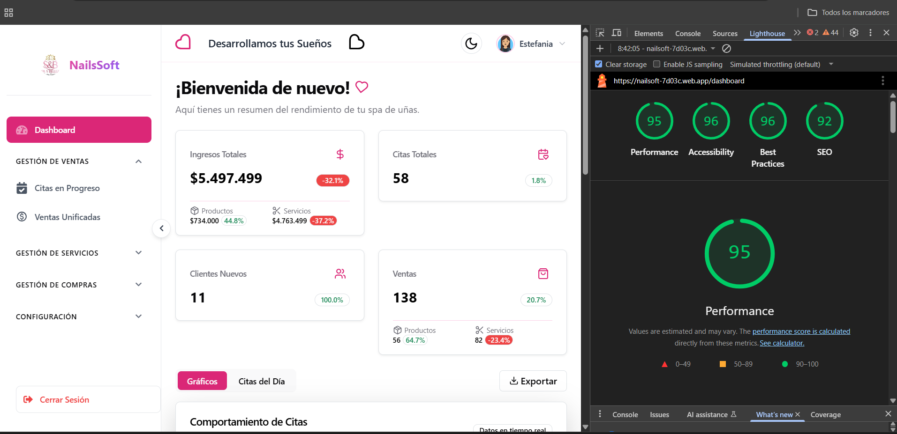
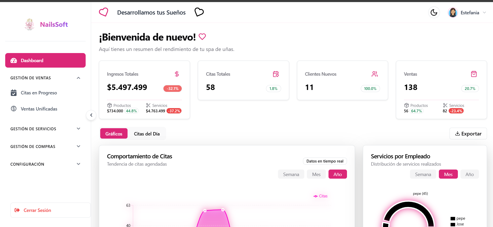
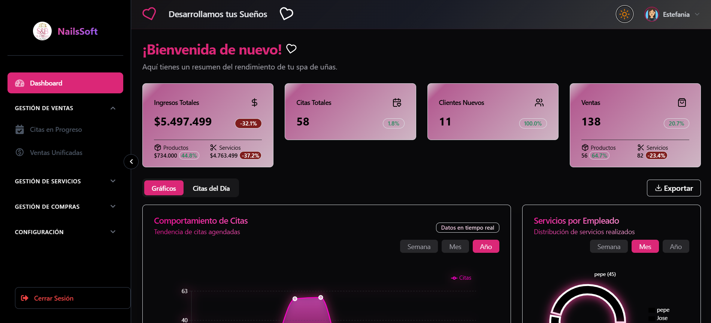
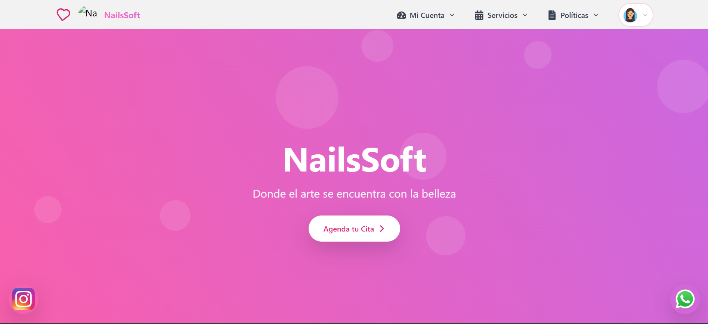
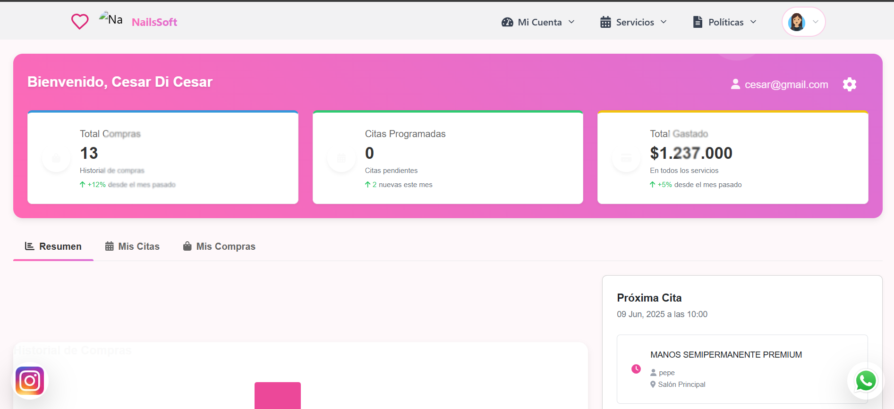
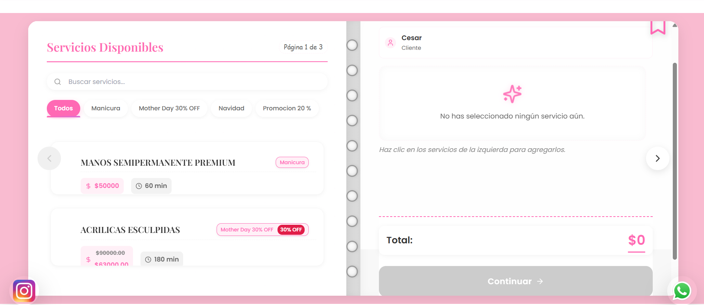

# NailSoft — Sistema de gestión para el Spa "S&B"

NailSoft es un sistema web y móvil para gestionar un spa de diseño de uñas: agendamiento de citas con varios servicios, registro de ventas, compras de insumos y reportes, con permisos dinámicos por rol.

Proyecto formativo del **SENA** (Tecnólogo en Análisis y Desarrollo de Software), desarrollado entre febrero y junio de 2025.


## Despliegue

El proyecto se despliega en cuentas propias de MongoDB Atlas, Render y Firebase, desde una base de datos vacía. La guía paso a paso está en [docs/DESPLIEGUE.md](docs/DESPLIEGUE.md).

## Equipo

- Sebastián Álvarez Restrepo
- Cristian Camilo Torres Arboleda
- Luis Mario Correa Gil
- Frank Javier Oronó Paternina

> **Sobre este repositorio:** es una copia del [repositorio original del equipo](https://github.com/IHomoSapienI/ProyectoNailSoft), que mantengo en mi cuenta para seguir mejorando el proyecto. El código base fue desarrollado por todo el equipo.

## Tecnologías

| Parte | Tecnologías |
|-------|-------------|
| Frontend web | React + Vite, Tailwind CSS, Material UI |
| Backend | Node.js, Express, JWT, Joi, Nodemailer |
| Base de datos | MongoDB Atlas (Mongoose) |
| App móvil | Flutter (Dart) |
| Pruebas | Jest, Supertest |
| Despliegue | Firebase Hosting (web), Render (API) |

## Funcionalidades

- **Roles y permisos dinámicos:** los permisos se asignan a cada rol desde la aplicación, sin depender de roles fijos en el código.
  - **Administrador:** gestión completa (usuarios, servicios, ventas, compras, reportes).
  - **Empleado:** agenda, citas y servicios prestados.
  - **Cliente:** reserva de citas y galería de servicios.
- **Citas** con selección de varios servicios y agenda por empleado.
- **Ventas** con descuentos, y **compras y bajas** de insumos.
- **Reportes** estadísticos visuales.
- **Recuperación de contraseña** por correo.
- **Modo claro y oscuro**, diseño 100 % responsive.
- **App móvil** para que el administrador consulte citas, ventas y empleados.
- Más de 90 en todas las métricas de Google Lighthouse.

## Instalación local

### Requisitos

- Node.js 22 (con Node 26 el backend no arranca por una incompatibilidad de `jsonwebtoken`)
- Una base de datos MongoDB (local o Atlas)

### 1. Backend

```bash
cd Backend
npm install
cp .env.example .env   # luego llena los valores del .env
npm run db:init        # crea permisos, roles y el administrador en una base vacía
npm start              # la API queda en http://localhost:3000
```

### 2. Frontend

```bash
cd Frontend
npm install
npm run dev            # http://localhost:5173, usa la API local automáticamente
```

Los detalles de cada variable de entorno están en [docs/DESPLIEGUE.md](docs/DESPLIEGUE.md).

### 3. Pruebas del backend

```bash
cd Backend
npm test
```

## Estado del proyecto

Versión 1.0.0 — proyecto finalizado (SENA, 2025).

## Galería

### Métricas de Lighthouse


### Panel de administrador, modo claro


### Panel de administrador, modo oscuro


### Landing para clientes


### Reportes


### Galería de servicios


### Agendamiento de citas


## Licencia

[Creative Commons Atribución-NoComercial 4.0 Internacional (CC BY-NC 4.0)](LICENSE).
