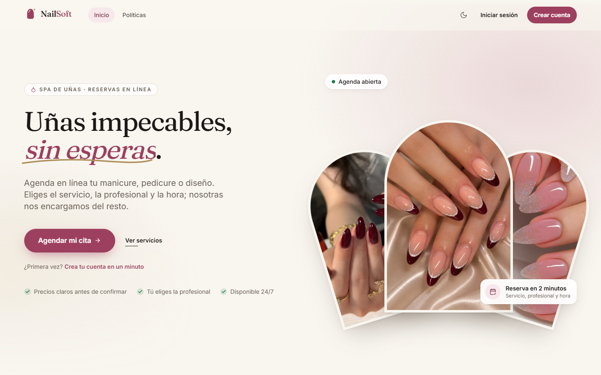
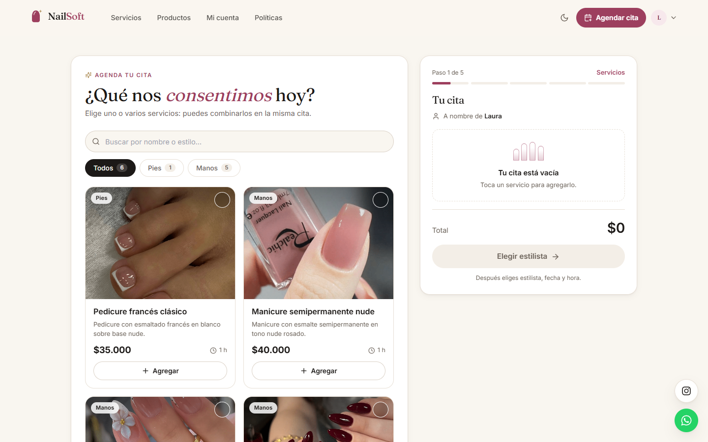
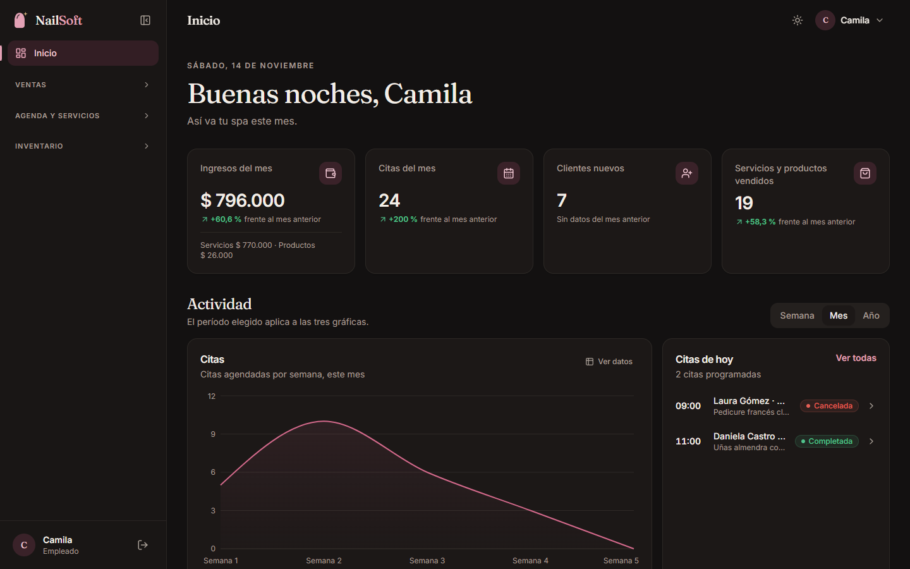
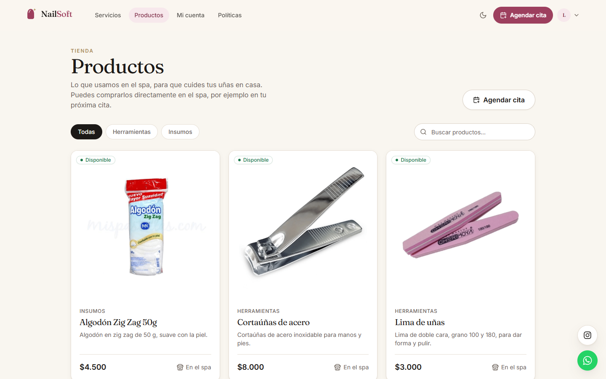
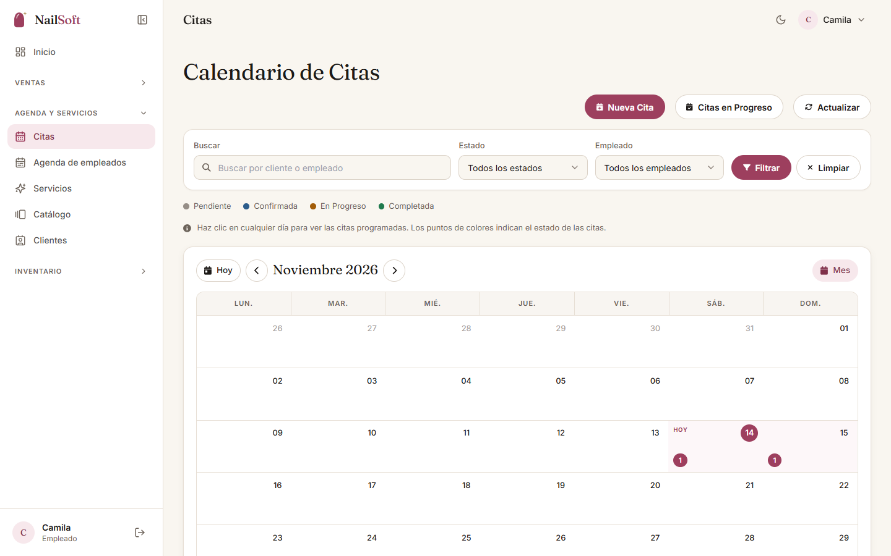
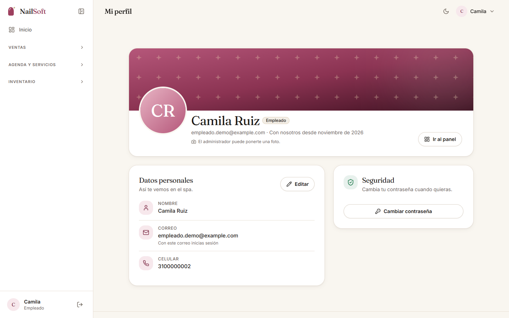
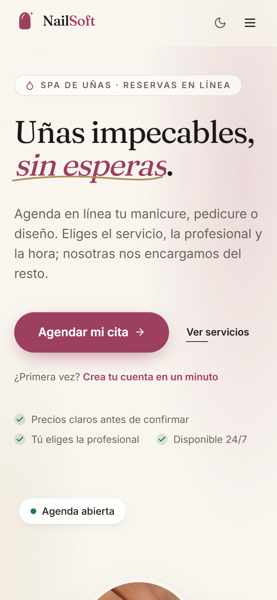
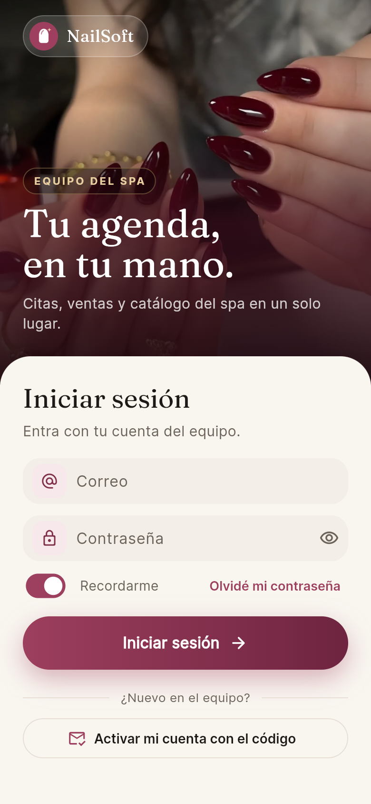
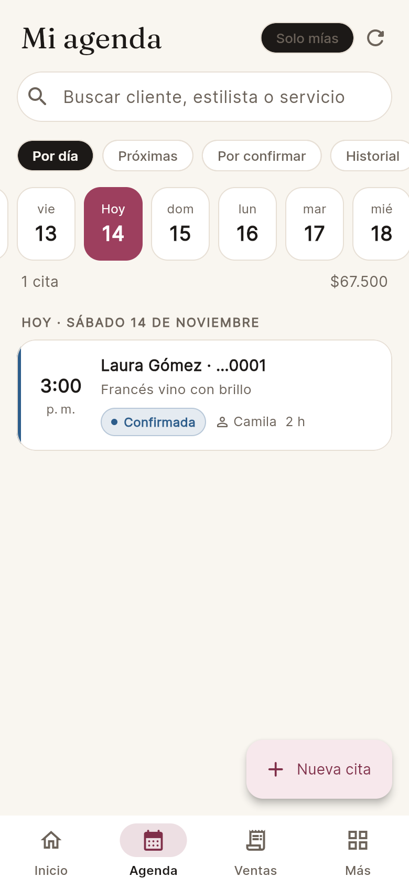

# NailSoft — Reservas y gestión para un spa de uñas

[](https://github.com/FrankPater15/NailSoftMejorado/actions/workflows/ci.yml)

Sistema completo para un spa de uñas: las clientas agendan en línea, el equipo maneja su agenda y cobra desde el celular, y la administración ve ventas, inventario y reportes.

**Web en vivo:** [nailsoft-spa.web.app](https://nailsoft-spa.web.app) · **App Android:** [descargar APK](https://github.com/FrankPater15/NailSoftMejorado/releases/latest)



## De dónde viene

NailSoft nació como proyecto formativo del **SENA** (Tecnólogo en Análisis y Desarrollo de Software, 2025), hecho en equipo por:

- Sebastián Álvarez Restrepo
- Cristian Camilo Torres Arboleda
- Luis Mario Correa Gil
- Frank Javier Oronó Paternina

Este repositorio es mi **rediseño** de ese proyecto, a partir de una copia del [repositorio original del equipo](https://github.com/IHomoSapienI/ProyectoNailSoft). Conservé todas las funciones del sistema original y lo rehice por dentro y por fuera: seguridad, diseño, experiencia de las clientas, la app móvil y las pruebas.

## Pruébalo

Entra en [nailsoft-spa.web.app](https://nailsoft-spa.web.app) con estas cuentas de demostración:

| Rol | Correo | Contraseña | Qué puedes ver |
|---|---|---|---|
| Clienta | `cliente.demo@example.com` | `Cliente4afeb9#28` | Agendar una cita paso a paso, la tienda y "Mi cuenta" |
| Estilista | `empleado.demo@example.com` | `Empleado78dcfc#62` | Panel, calendario de citas, agenda, ventas y clientes (también en la app) |

> El servidor está en el plan gratuito de Render y se duerme cuando nadie lo usa: **la primera carga puede tardar cerca de un minuto**. Después va normal.
>
> Las cuentas de demostración son compartidas, así que el servidor no deja cambiarles datos ni contraseña. Los nombres, teléfonos y redes del spa son ficticios.

## Antes y después

| Proyecto original (2025) | Rediseño |
|---|---|
|  |  |
|  |  |
|  |  |

## Qué cambió en el rediseño

**Seguridad**
- Se cerraron huecos críticos del servidor: cada clienta solo puede ver y tocar sus propios datos, los permisos se revisan en el servidor y no solo en la pantalla, y las rutas de administración piden el rol correcto.
- Login más seguro: límites de intentos, contraseñas robustas, sesiones que se cierran al cambiar la contraseña y tokens distintos para sesión, recuperación y activación.
- Las estilistas nuevas no reciben contraseña: les llega un **código de 5 dígitos** al correo para activar su cuenta y elegir la suya.
- Ninguna pantalla muestra en la consola del navegador datos de clientas. Los celulares se muestran solo con los últimos 4 dígitos.

**Diseño y experiencia**
- Sistema de diseño propio (colores, tipografía, componentes) con modo claro y oscuro, en lugar de la marca y los estilos del original.
- Portada animada y galería de diseños de uñas.
- Agendar en 5 pasos claros: servicios, estilista (con su foto), fecha, hora y confirmación. No deja elegir horas pasadas ni domingos.
- Correos de confirmación y recordatorio de las citas.
- Tienda de productos y "Mi cuenta" para ver citas y compras.
- Perfil con datos editables, cambio de contraseña y fotos de las estilistas (solo el administrador las gestiona).

**App móvil (rehecha)**
- App Flutter para el equipo del spa: agenda del día, crear citas, iniciar y cobrar (con productos y descuentos), servicios con foto, descuentos y equipo.
- Activación de la cuenta con el código del correo y recuperación de contraseña desde la app.

**Infraestructura y calidad**
- Imágenes en Cloudinary (el disco de Render se borra en cada despliegue).
- Correo por cualquier servidor SMTP, por ejemplo Brevo.
- Más de 230 pruebas automáticas y CI en GitHub Actions en cada cambio.

## Galería

<table>
  <tr>
    <td width="50%"><br><sub>Tienda de productos</sub></td>
    <td width="50%"><br><sub>Calendario de citas del equipo</sub></td>
  </tr>
  <tr>
    <td width="50%"><br><sub>Perfil de una estilista</sub></td>
    <td width="50%"><br><sub>Panel en modo oscuro</sub></td>
  </tr>
</table>

<p>
  
  
  
</p>
<sub>Web en el celular · App Android: inicio de sesión y agenda del día</sub>

## Tecnologías

| Parte | Tecnologías |
|---|---|
| Web | React 18, Vite, Tailwind CSS, Framer Motion, React Router |
| Servidor | Node.js 22, Express, JWT, Joi, Nodemailer, Multer |
| Base de datos | MongoDB Atlas (Mongoose) |
| App móvil | Flutter 3 (Dart) |
| Imágenes y correo | Cloudinary, Nodemailer con cualquier SMTP |
| Pruebas | Jest + Supertest (servidor), Vitest + Testing Library (web), flutter_test (app) |
| Despliegue | Firebase Hosting (web), Render (API), GitHub Actions (CI) |

## Funciones

- **Roles y permisos dinámicos:** los permisos se asignan a cada rol desde la aplicación.
  - **Administrador:** todo el sistema (usuarios, roles, servicios, ventas, compras, inventario, reportes).
  - **Estilista:** su agenda, citas, ventas y clientes, en la web y en la app.
  - **Clienta:** agendar, ver sus citas y compras, tienda y perfil.
- **Citas** con varios servicios, agenda por estilista y estados (pendiente, confirmada, en progreso, completada, cancelada).
- **Ventas** con descuentos por tipo de servicio, y **compras y bajas** de insumos.
- **Reportes** del mes y del año.
- **Recuperación de contraseña** y **activación de cuentas** por código al correo.

## Pruebas

| Parte | Pruebas | Comando |
|---|---|---|
| Servidor | 151 (Jest + Supertest) | `cd Backend && npm test` |
| Web | 65 (Vitest + Testing Library) | `cd Frontend && npm test` |
| App | 26 (flutter_test) | `cd mobile && flutter test` |

El [CI](.github/workflows/ci.yml) corre en cada push y pull request: pruebas del servidor; lint, pruebas y compilación de la web; y análisis y pruebas de la app. No necesita base de datos ni claves: los modelos y el correo están simulados.

## Instalación local

### Requisitos

- Node.js 22 (con Node 26 el servidor no arranca por una incompatibilidad de `jsonwebtoken`)
- Una base de datos MongoDB (local o Atlas)
- Flutter 3.47 para la app (opcional)

### 1. Servidor

```bash
cd Backend
npm install
cp .env.example .env   # luego llena los valores del .env
npm run db:init        # crea permisos, roles y el administrador en una base vacía
npm run db:demo        # opcional: protege las cuentas de demostración
npm start              # la API queda en http://localhost:3000
```

### 2. Web

```bash
cd Frontend
npm install
npm run dev            # http://localhost:5173, usa la API local automáticamente
```

### 3. App móvil

```bash
cd mobile
flutter pub get
flutter run --dart-define=API_URL=http://10.0.2.2:3000/api   # emulador de Android
```

Cada variable de entorno y el despliegue en cuentas propias (MongoDB Atlas, Render, Firebase, Cloudinary) están explicados en [docs/DESPLIEGUE.md](docs/DESPLIEGUE.md).

## Autoría y licencia

- **Proyecto original (2025):** equipo NailSoft del SENA, nombrado arriba.
- **Rediseño y desarrollo (2026):** Frank Paternina (Frank Javier Oronó Paternina). El [historial de commits](https://github.com/FrankPater15/NailSoftMejorado/commits/main) muestra cada fase con su fecha.

Licencia [Creative Commons Atribución-NoComercial 4.0 (CC BY-NC 4.0)](LICENSE): puedes usar y modificar el código sin fines comerciales, dando crédito a los autores y enlazando a este repositorio.
